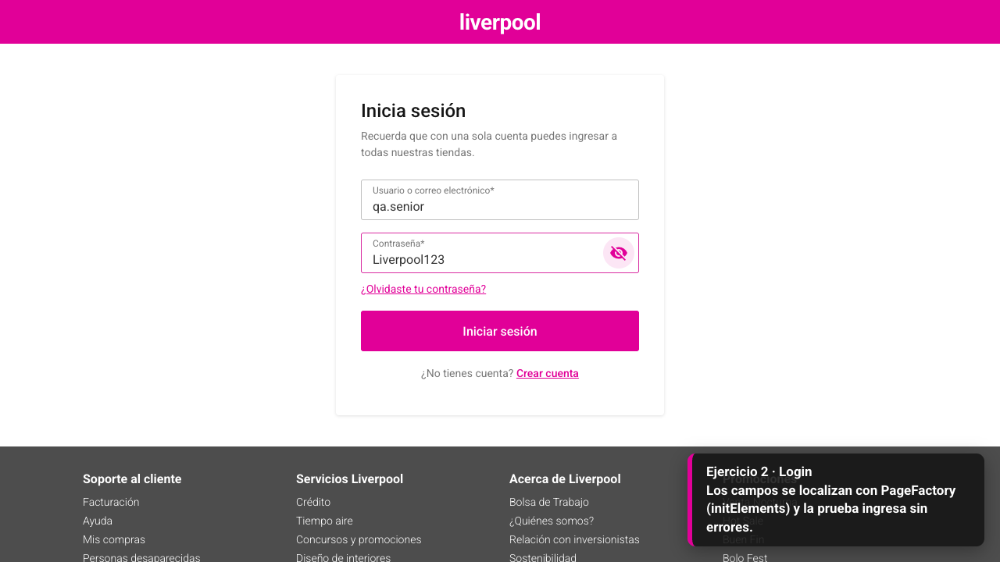
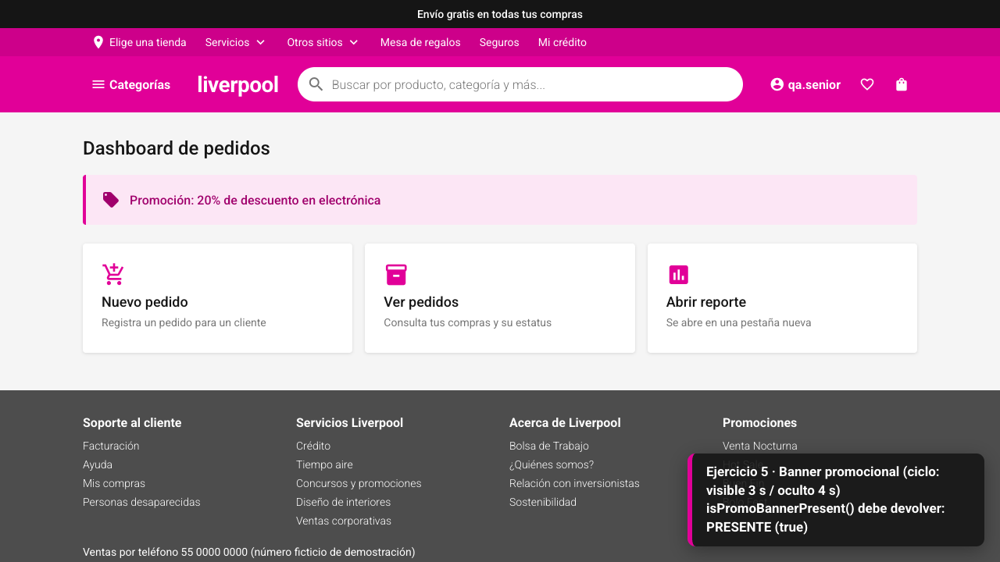
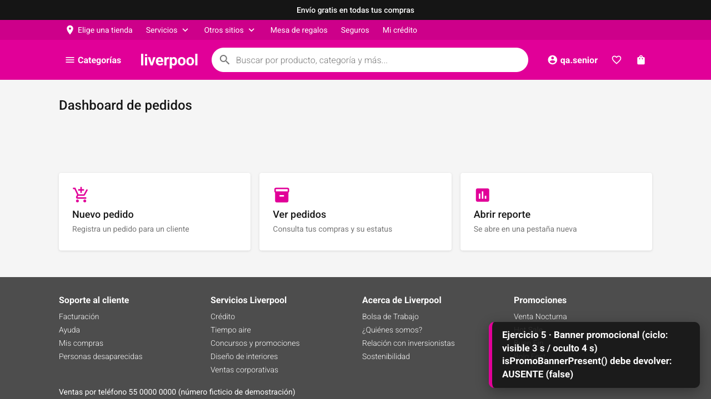
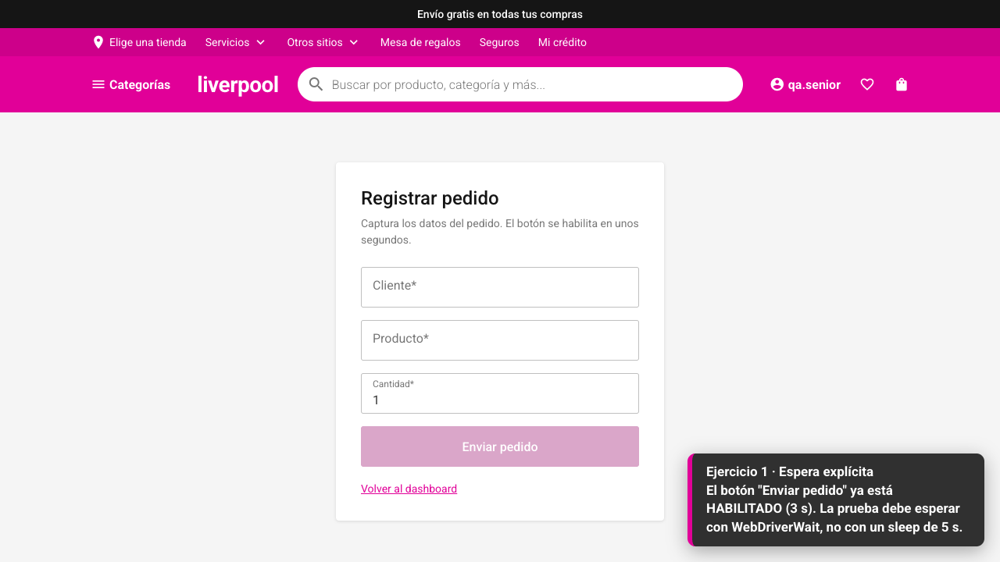
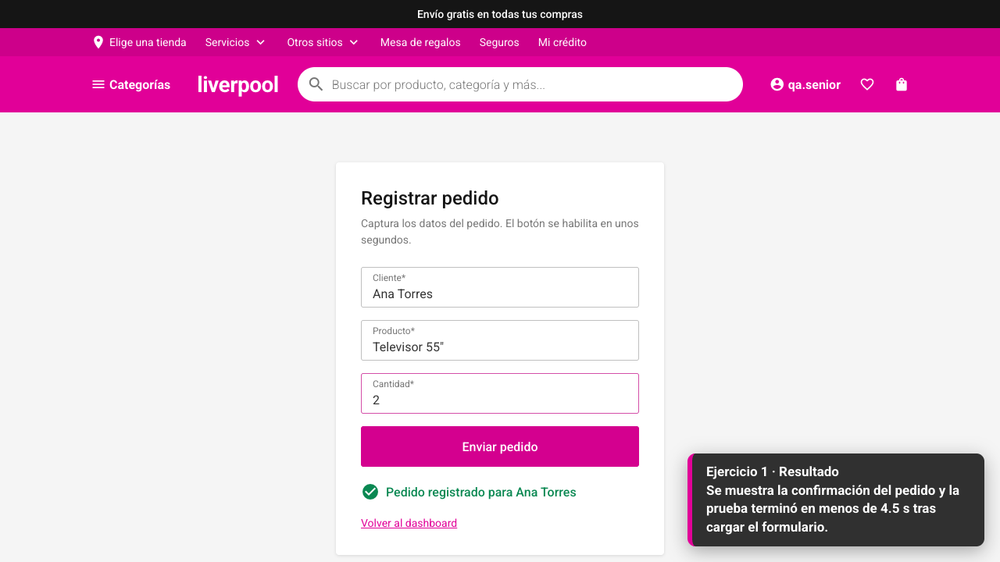
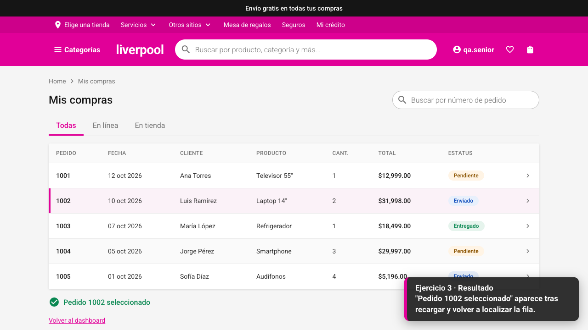
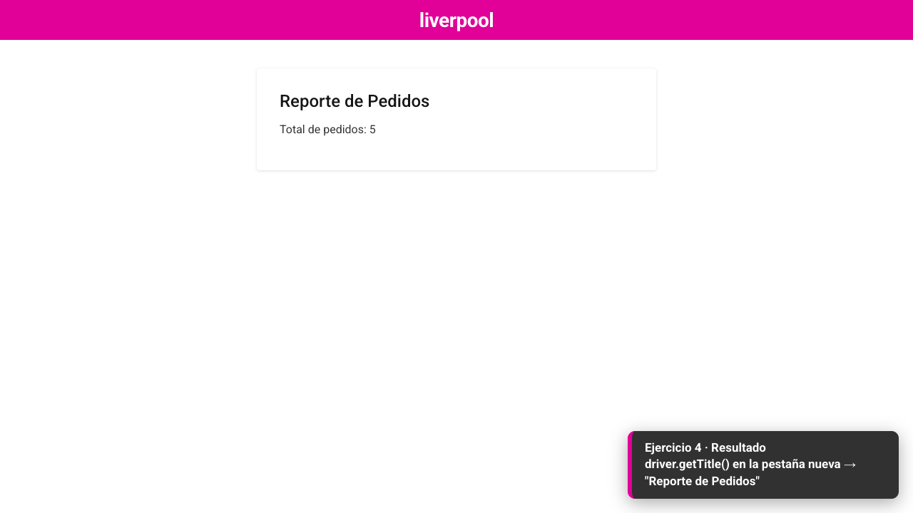
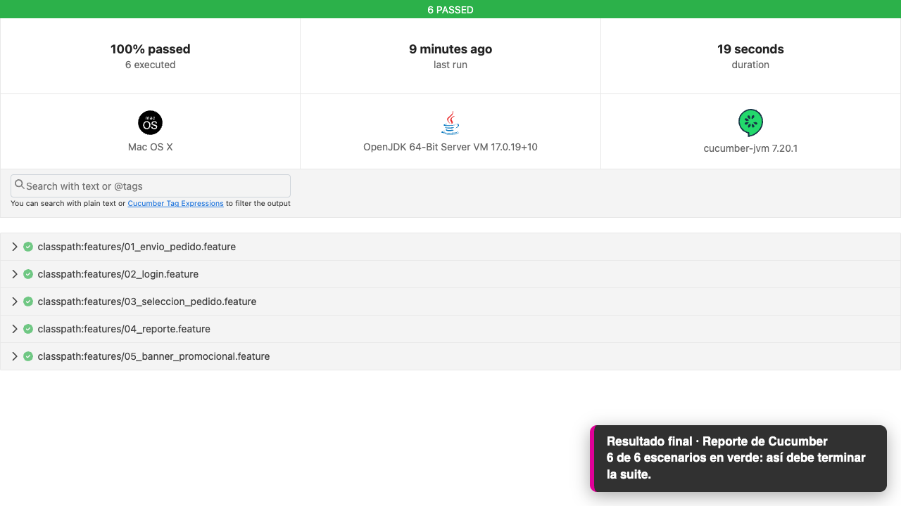

# Guía del evaluador — Reto de QA Automation Senior (30 min)

> **Uso exclusivo del evaluador. No compartir con el candidato** (el video `media/estado-al-100.mp4` explica las soluciones en sus subtítulos; el del candidato es `media-candidato/`). Esta carpeta (`evaluador/`) nunca entra a la imagen
> de la workstation del candidato; la construcción de la imagen falla si se cuela (`infra/workstation/scripts/check-seed.sh`).

## Contenido

| Archivo | Para qué sirve |
|---------|----------------|
| `README.md` | Esta guía. |
| `progreso.py` | Mide en vivo cuántos ejercicios lleva resueltos el candidato (0/5 … 5/5). |
| `monitor.py` | Mide **todas** las workstations del reto a la vez, desde tu máquina (ver «Monitor automático»). |
| `soluciones/ej1.patch … ej5.patch` | Solución de referencia de cada ejercicio (independientes entre sí). |
| `verificar-soluciones.sh` | Prueba que los parches funcionan sobre la rama sembrada (úsalo si cambias algo). |
| `salidas/ejN-fallo.txt` | Salida **real** de cada fallo sembrado. |
| `media/estado-al-100.mp4` | Video (71 s, con subtítulos) de la app y la suite funcionando al 100 %. |
| `media/*.png` | Capturas del estado final esperado. |
| `media-candidato/estado-esperado.mp4` | Mismo recorrido con subtítulos **neutros** (sin técnicas ni soluciones). Es el que ve el candidato: la imagen del reto lo incluye como `referencia/estado-esperado.mp4` y el IDE lo abre solo como primera pestaña. |
| `video/` | Generador del video (Playwright). Solo para regenerarlo. |

---

## 1. Qué se evalúa y cómo está montado el examen

El candidato recibe un proyecto con una app de pedidos y una suite Selenium/Cucumber en Java. La suite falla en
**5 ejercicios** por defectos sembrados en la automatización (nunca en la app). Debe diagnosticar cada fallo con los
tickets de `docs/tickets/QA-101…105.md`, corregirlo y dejar la suite en verde en 30 minutos, sin IA ni internet.

- **Rama del reto:** `challenge-30mins` (la línea base sin defectos es `development`).
- **Qué ve el candidato:** `/home/user/qa-challenge` (repositorio git de un solo commit "Estado inicial del reto"), un
  `README.md` propio con las reglas y `docs/tickets/`. No ve `openspec`, `infra`, `evaluador` ni este banco de errores.
- **Qué NO debe tocar:** `app-web/` ni `automation/src/test/` (features, steps, soporte). El problema está en los Page Objects.

### Reglas del examen (las ve el candidato)

Sin IA generativa · sin internet · autocompletado del IDE permitido · 30 minutos · no cambiar la app.

---

## 2. Arquitectura del proyecto

```
 Navegador del candidato
        |
        v
 +------------------------ Workstation (Code OSS, sin internet) ------------------------+
 |                                                                                      |
 |   terminal:  cd automation && mvn test                                               |
 |                      |                                                               |
 |                      v                                                               |
 |  +---------------------------- automation/ (Java 17, Maven) ---------------------+   |
 |  |  features/*.feature  (Gherkin en espanol, "# language: es")                    |   |
 |  |        |                                                                       |   |
 |  |        v                                                                       |   |
 |  |  steps/*  (Cucumber + PicoContainer, comparten ScenarioContext)                |   |
 |  |        |                                                                       |   |
 |  |        v                                                                       |   |
 |  |  pages/*  <-- AQUI estan los 5 defectos (un metodo por Page Object)            |   |
 |  |        |                                                                       |   |
 |  |        v                                                                       |   |
 |  |  Selenium 4 -> ChromeDriver -> Chrome headless                                 |   |
 |  |        ^                                                                       |   |
 |  |  steps/Hooks (ciclo de vida del driver) + support/: DriverFactory, AppServer     |   |
 |  |  (levanta app-web), ExceptionRecorder (listener), SessionHelper (login de fondo)|   |
 |  +--------------------------------------------------------------------------------+   |
 |                      |  http://localhost:5199                                        |
 |                      v                                                               |
 |  +------------------- app-web/ (React 18 + Vite, sin backend) --------------------+   |
 |  |  /  login  ->  /dashboard  ->  /pedidos/nuevo  |  /pedidos  |  /reporte (tab)   |   |
 |  +--------------------------------------------------------------------------------+   |
 +--------------------------------------------------------------------------------------+
```

Piezas que conviene conocer para responder dudas:

- **`AppServer`** levanta `npm run dev` solo si la app no está disponible (puerto **5199**) y valida que el servicio sea esta app
  (por el `title` del `index.html`). La suite tiene **6 escenarios** (el ejercicio 5 tiene dos: banner oculto y banner visible).
- **`SessionHelper`** hace el login "de fondo" (`Dado que el usuario … inició sesión …`) de los escenarios 1, 3, 4 y 5 **sin usar
  `LoginPage`**, por eso el defecto 2 no rompe los demás escenarios.
- **`ExceptionRecorder`** es un listener de WebDriver (`EventFiringDecorator`) que registra las excepciones lanzadas; el
  escenario 5 lo usa para detectar `NoSuchElementException`. La suite trabaja con *implicit wait* = 0.
- **Tiempos simulados de la app** (deterministas): el botón *Enviar pedido* se habilita a los **3 s**; el banner promocional está
  **visible 3 s y oculto 4 s**, en ciclo.
- **Credenciales:** `qa.senior` / `Liverpool123`. Los IDs de los elementos no cambian (`username`, `submit-form`, `promo-banner`, …).

### Mapa ejercicio → archivo

| # | Ticket | Feature | Page Object y método | Tema |
|---|--------|---------|----------------------|------|
| 1 | QA-101 | `01_envio_pedido` | `PedidoFormPage.clickSubmitButton()` | Sincronización: espera explícita |
| 2 | QA-102 | `02_login` | constructor de `LoginPage` | Page Object con `PageFactory` |
| 3 | QA-103 | `03_seleccion_pedido` | `PedidosTablePage.clickRowAfterRefresh()` | `StaleElementReferenceException` |
| 4 | QA-104 | `04_reporte` | `ReportPage.verifyNewTabTitle()` | Varias pestañas: `WindowHandle` |
| 5 | QA-105 | `05_banner_promocional` | `DashboardPage.isPromoBannerPresent()` | Control de flujo por excepciones |

---

## 3. Temas del reto

1. **Sincronización** — esperas implícitas, explícitas y fluidas; por qué un `Thread.sleep` es un defecto.
2. **Page Object y PageFactory** — proxies perezosos de `@FindBy`, cuándo se inicializan.
3. **Elementos obsoletos (stale)** — qué invalida una referencia y cómo diseñar localizadores bajo demanda.
4. **Múltiples ventanas** — `getWindowHandles()`, `switchTo().window()`, condición de carrera al abrir la pestaña.
5. **Anti-patrones** — usar excepciones como control de flujo; `findElement` vs `findElements`.
6. **Hábitos de senior** — leer el stack trace antes de tocar código, cambiar lo mínimo, no "hacer pasar" la prueba
   modificando features o steps, y poder explicar el *por qué*.

---

## 4. Los ejercicios, uno por uno

> Los `mvn` se ejecutan **desde `automation/`** y los `grep` desde la raíz del proyecto, en la rama `challenge-30mins`. La salida mostrada es real
> (guardada en `salidas/`). Las soluciones completas están en `soluciones/ejN.patch`.
> **El ejercicio se considera resuelto solo si el escenario pasa *y* se usó la técnica esperada**
> (`progreso.py` distingue ambos casos).

### Ejercicio 1 — Espera fija en el envío del formulario (QA-101)

**Qué ve el candidato:** la prueba tarda mucho y falla la verificación de tiempo.

**Reproducir**

```bash
cd automation && mvn test -Dcucumber.features=src/test/resources/features/01_envio_pedido.feature
```

```text
java.lang.AssertionError: 
[Tiempo hasta el clic (ms)] 
Expecting actual:
  5243L
to be less than:
  4500L 
	at com.liverpool.playground.steps.PedidoFormSteps.envioEnTiempoRazonable(PedidoFormSteps.java:52)
```

(El valor exacto varía por corrida: ~5,2 s, siempre por encima del límite de 4,5 s.)

**Pista rápida en el código:** `grep -rn "Thread.sleep" automation/src/main` → `PedidoFormPage.clickSubmitButton()`.

**Causa raíz:** pausa fija de 5 s. El botón se habilita a los 3 s, así que se pierden ~2 s siempre, y en máquinas lentas
puede no estar listo en 5 s.

**Solución esperada**

```java
public void clickSubmitButton() {
    new WebDriverWait(driver, Duration.ofSeconds(10))
            .until(ExpectedConditions.elementToBeClickable(submitButton))
            .click();
}
```

**Errores típicos**
- Bajar el sleep a 3–4 s: pasa el escenario pero **sigue siendo una espera fija** (`progreso.py` → `PASA_SIN_TECNICA`).
- Esperar `visibilityOf`/presencia en lugar de *clickable*: el botón es visible pero está deshabilitado 3 s; el clic no hace
  nada y la confirmación nunca aparece.
- Subir un *implicit wait* global: oculta el problema y arruina otras esperas (y el ejercicio 5).

**Preguntas de seguimiento**
- ¿Diferencia entre implicit, explicit y fluent wait? ¿Por qué no mezclar implicit con explicit?
- ¿Cómo eliges el timeout y el intervalo de sondeo? ¿Qué pasa si el timeout es muy grande en CI?
- ¿Cómo medirías que la espera no está añadiendo tiempo muerto?

**Pistas (de menos a más)**
1. *"Compara cuánto dura el escenario con lo que tarda la app en habilitar el botón."*
2. *"Mira el método que hace clic en Enviar: ¿qué espera hace hoy?"*
3. *"Sustituye esa pausa por una espera condicionada a que el botón sea clicable."*

---

### Ejercicio 2 — Page Object sin inicializar (QA-102)

**Qué ve el candidato:** error inmediato en el primer paso de login; "el campo no existe" aunque se ve en pantalla.

**Reproducir**

```bash
cd automation && mvn test -Dcucumber.features=src/test/resources/features/02_login.feature
```

```text
java.lang.NullPointerException: Cannot invoke "org.openqa.selenium.WebElement.clear()" because "this.usernameInput" is null
	at com.liverpool.playground.pages.LoginPage.enterUsername(LoginPage.java:36)
	at com.liverpool.playground.steps.LoginSteps.capturaCredenciales(LoginSteps.java:34)
```

**Pista rápida en el código:** `LoginPage` declara `@FindBy` pero su constructor no llama a `PageFactory`.

**Causa raíz:** los campos `@FindBy` se quedan en `null` porque nadie ejecuta `PageFactory.initElements`.

**Solución esperada**

```java
public LoginPage(WebDriver driver) {
    this.driver = driver;
    PageFactory.initElements(driver, this);
}
```

**Errores típicos**
- Inicializar solo en `open()`: no basta, porque cada paso de `LoginSteps` crea un `new LoginPage(...)` distinto y el que captura
  las credenciales nunca pasó por `open()`; el escenario sigue fallando. Debe inicializarse en el constructor.
- Reemplazar todo por `driver.findElement(...)` en cada método: **es válido** (el script lo acepta), pero conviene preguntar
  por qué abandonó el patrón.
- Añadir `@CacheLookup` "por si acaso": introduce riesgo de elementos obsoletos.

**Preguntas de seguimiento**
- ¿Qué hace exactamente `initElements`? ¿Cuándo se busca el elemento en el DOM (proxy perezoso)?
- ¿Qué ventajas y riesgos tiene `@CacheLookup`?
- ¿Cómo estructuras Page Objects para que cada pantalla devuelva la siguiente (fluent)?

**Pistas**
1. *"El mensaje habla de un campo `null`: ¿quién debería haberle dado valor?"*
2. *"Revisa qué pasa en el constructor de `LoginPage`."*
3. *"Falta inicializar los elementos anotados con `@FindBy` al construir la página."*

---

### Ejercicio 3 — Fila obsoleta tras recargar (QA-103)

**Qué ve el candidato:** la tabla se ve bien, pero el clic en la fila falla tras recargar con "elemento ya no es válido".

**Reproducir**

```bash
cd automation && mvn test -Dcucumber.features=src/test/resources/features/03_seleccion_pedido.feature
```

```text
org.openqa.selenium.StaleElementReferenceException: 
stale element reference: stale element not found
Element: [[ChromeDriver: ...] -> css selector: tr[data-id='1002']]
	at com.liverpool.playground.pages.PedidosTablePage.clickRowAfterRefresh(PedidosTablePage.java:27)
```

**Pista rápida en el código:** en `clickRowAfterRefresh` la fila se obtiene **antes** de `refresh()`.

**Causa raíz:** la referencia al `WebElement` se capturó antes de recargar; el refresh crea un DOM nuevo y la referencia
guardada queda obsoleta.

**Solución esperada**

```java
public void clickRowAfterRefresh(String pedidoId) {
    driver.navigate().refresh();
    WebElement rowItem = waitForRow(pedidoId);
    rowItem.click();
}
```

**Errores típicos**
- Añadir un `Thread.sleep` después del refresh: **no arregla nada** (la referencia sigue obsoleta).
- Envolver el clic en `try/catch` de `StaleElementReferenceException` con reintento: funciona y el script lo acepta, pero es
  un parche; pregunta si habría bastado con localizar después.
- Volver a ubicar la fila antes del refresh "por si acaso".

**Preguntas de seguimiento**
- ¿Qué provoca un `StaleElementReferenceException`? ¿Solo los refresh?
- ¿Qué hace `ExpectedConditions.refreshed(...)`? ¿Cuándo lo usarías?
- ¿Por qué guardar `WebElement` en campos es una mala idea en páginas dinámicas?

**Pistas**
1. *"El error dice que el elemento ya no es válido: ¿qué ocurrió con la página entre localizarlo y hacer clic?"*
2. *"Mira el orden de las líneas en `clickRowAfterRefresh`."*
3. *"Localiza la fila después de recargar, no antes."*

---

### Ejercicio 4 — Título de la pestaña equivocada (QA-104)

**Qué ve el candidato:** el título obtenido es el del dashboard, no el del reporte.

**Reproducir**

```bash
cd automation && mvn test -Dcucumber.features=src/test/resources/features/04_reporte.feature
```

```text
org.opentest4j.AssertionFailedError: 

expected: "Reporte de Pedidos"
 but was: "Dashboard - Pedidos Playground"
	at com.liverpool.playground.steps.ReportSteps.tituloEs(ReportSteps.java:40)
```

**Pista rápida en el código:** `ReportPage.verifyNewTabTitle()` espera 2 ventanas pero nunca llama a `switchTo().window(...)`.

**Causa raíz:** el enlace abre una pestaña nueva, pero el *driver* sigue enfocado en la original.

**Solución esperada**

```java
public String verifyNewTabTitle() {
    String originalHandle = driver.getWindowHandle();
    WebDriverWait wait = new WebDriverWait(driver, Duration.ofSeconds(10));
    wait.until(ExpectedConditions.numberOfWindowsToBe(2));
    for (String handle : driver.getWindowHandles()) {
        if (!handle.equals(originalHandle)) {
            driver.switchTo().window(handle);
            break;
        }
    }
    wait.until(d -> "complete".equals(
            ((JavascriptExecutor) d).executeScript("return document.readyState")));
    return driver.getTitle();
}
```

**Errores típicos**
- Tomar `getWindowHandles().iterator().next()` (puede ser la original): comportamiento no determinista.
- Cambiar de ventana **sin esperar** a que existan 2 (condición de carrera).
- Leer el título antes de que cargue (`document.readyState`).
- No volver a la pestaña original: no rompe este escenario, pero sí un posible escenario siguiente.

**Preguntas de seguimiento**
- ¿Qué es un *window handle*? ¿Es estable? ¿El orden del `Set` está garantizado?
- ¿Cómo cerrarías la pestaña nueva y regresarías a la original?
- ¿Cómo lo harías con Selenium 4 (`switchTo().newWindow`)? ¿En qué se diferencia?

**Pistas**
1. *"A mano el título es correcto; ¿en qué pestaña está mirando el driver?"*
2. *"Revisa qué hace `verifyNewTabTitle` entre esperar la ventana y leer el título."*
3. *"Hay que cambiar el foco a la ventana nueva antes de leer el título."*

---

### Ejercicio 5 — Existencia por excepciones (QA-105)

**Qué ve el candidato:** la consulta del banner devuelve el valor correcto pero deja errores en el registro de la ejecución.

**Reproducir**

```bash
cd automation && mvn test -Dcucumber.features=src/test/resources/features/05_banner_promocional.feature
```

```text
java.lang.AssertionError: 
[NoSuchElementException registradas durante la consulta] 
Expecting empty but was: [org.openqa.selenium.NoSuchElementException]
	at com.liverpool.playground.steps.PromoBannerSteps.sinExcepciones(PromoBannerSteps.java:49)
```

Solo falla el escenario con el banner **oculto**; el escenario con el banner visible pasa.

**Pista rápida en el código:** `grep -rn "NoSuchElementException" automation/src/main` → `DashboardPage.isPromoBannerPresent()`.

**Causa raíz:** `findElement` + `try/catch (NoSuchElementException)` usa una excepción como control de flujo; cuando el banner no
está, la excepción se lanza y queda registrada.

**Solución esperada**

```java
public boolean isPromoBannerPresent() {
    return !driver.findElements(PROMO_BANNER).isEmpty();
}
```

**Notas para el evaluador**
- En ChromeDriver el *implicit wait* también aplica a `findElements` cuando la lista está vacía (espera el timeout completo). Por eso
  la suite usa implicit = 0 y detecta el anti-patrón con el listener, **no por tiempo**.
- Subir el implicit wait o envolver `findElements` en `try/catch` no arregla el fondo del problema.

**Errores típicos**
- Mantener el `try/catch` pero cambiar `findElement` por `findElements` (el script → `PASA_SIN_TECNICA`).
- Usar `ExpectedConditions.invisibilityOf...` para devolver un booleano: añade espera y complica.
- Confundir *presente en el DOM* con *visible*.

**Preguntas de seguimiento**
- ¿Por qué es mala idea usar excepciones para decidir un flujo? (coste, ruido, intención poco clara)
- ¿Diferencia entre presente y visible? ¿Qué devuelve `findElements` si no hay coincidencias?
- ¿Cómo esperarías hasta que el banner aparezca sin lanzar excepciones propias?

**Pistas**
1. *"El valor devuelto es correcto; fíjate en lo que el log registra mientras se calcula."*
2. *"Mira cómo `isPromoBannerPresent` decide que algo no existe."*
3. *"Hay una consulta que devuelve una lista (posiblemente vacía) en lugar de lanzar."*

---

## 5. Medir el avance en vivo: `progreso.py`

Ejecuta la suite sobre **una copia** del trabajo del candidato (no toca sus archivos ni compite por el puerto: usa el 5299) y
combina dos señales por ejercicio: el escenario y una revisión del código.

| Estado | Significado |
|--------|-------------|
| `RESUELTO` | El escenario pasa **y** se usó la técnica esperada (acepta alternativas válidas). |
| `PASA_SIN_TECNICA` | El escenario pasa, pero con un parche (p. ej. `sleep(3500)` o `try/catch`). |
| `FALLA` | El escenario sigue fallando (muestra el mensaje). |
| `NO_COMPILA` | El proyecto no compila. |

Además informa los **archivos fuera de alcance** (`app-web/`, `automation/src/test/`) y, como en la copia la app y los tests se
restauran desde el commit inicial, editar un `.feature` **no ayuda** al candidato. Guarda en `~/.evaluador/progreso.jsonl` el
instante en que cada ejercicio quedó en verde.

### Cómo ejecutarlo durante el examen

El script contiene las reglas (es decir, las respuestas), así que **no está en la imagen**. Desde tu **propia sesión** del IDE
(necesitas `roles/workstations.user` sobre la misma workstation: `infra/workstation/scripts/grant-access.sh CORREO`):

```bash
mkdir -p /tmp/.ev && cat > /tmp/.ev/progreso.py   # pega el contenido de evaluador/progreso.py y termina con Ctrl+D
python3 /tmp/.ev/progreso.py --vigilar 90          # evalúa cada 90 s hasta que todo esté resuelto
```

Opciones: `--ejercicios 1,2,3,4` (si retiras el 5), `--json`, `--reiniciar` (reinicia el cronómetro), `--trabajo RUTA`,
`--puerto N`. Código de salida: `0` todo resuelto · `1` faltan ejercicios · `2` error.
**Al terminar:** `rm -rf /tmp/.ev ~/.evaluador` (el candidato comparte el mismo usuario Linux y podría verlos).

Salida de ejemplo:

```text
EVALUACION  QA Automation Senior            tiempo: 18:42 / 30:00
------------------------------------------------------------------------------
 [x] 1 Espera explicita en el envio del formulario    RESUELTO  (verde a los 06:10)
 [x] 2 Inicializacion de elementos (PageFactory)      RESUELTO  (verde a los 09:30)
 [ ] 3 Fila obsoleta tras recargar (stale)            FALLA
       StaleElementReferenceException: stale element reference: stale element not found
 [~] 4 Cambio de pestana / WindowHandle               PASA_SIN_TECNICA
       el escenario pasa pero no cambia el foco a la pestana nueva (switchTo().window)
 [ ] 5 Existencia sin excepciones (findElements)      FALLA
       AssertionError: [NoSuchElementException registradas durante la consulta]
------------------------------------------------------------------------------
 Progreso: 2/5 resueltos
 Fuera de alcance: ninguno
```

Para revisar después en tu laptop: exporta el trabajo del candidato (`git diff` sobre el commit inicial) y corre el script con
`--trabajo` sobre esa copia.

---

### Monitor automático de todas las workstations: `monitor.py`

Las workstations no admiten SSH ni TCP (solo navegador) y `progreso.py` lleva las respuestas, así que **no se envía nada a las
workstations**: el flujo va al revés.

```text
workstation del candidato                         tu máquina
  agente (root, cada ~60 s)                         python3 evaluador/monitor.py --vigilar 120
  empaqueta /home/user/qa-challenge  ──►  bucket  ──►  descarga el último paquete de cada workstation en marcha
  (sin node_modules/target; con .git)   (solo crear)    y le aplica progreso.py sobre una copia
```

- El agente vive en la imagen del reto (`infra/workstation/agent/`) y solo se activa si la imagen se construyó con
  `PROGRESS_BUCKET=...` (la de `development` no lo lleva). Sube solo cuando hay cambios; registro en `/var/log/qa-progress.log`.
- La cuenta de servicio de las workstations tiene `roles/storage.objectCreator` sobre el bucket: **puede crear objetos, pero no
  listar, leer ni borrar**; el candidato no puede ver lo subido (ni lo de otros). El bucket borra los paquetes a los 7 días.
- La config del reto debe tener el alcance OAuth `devstorage.read_write` (con `read_only` Google rechaza la escritura aunque el
  IAM la permita): `SA_SCOPES=https://www.googleapis.com/auth/devstorage.read_write,https://www.googleapis.com/auth/logging.write,https://www.googleapis.com/auth/monitoring.write`
  al ejecutar `gcp-setup.sh config`. Un cambio de alcances solo aplica al **detener e iniciar** cada workstation.
- El README del candidato le avisa de que su código se copia para el seguimiento.
- Requisitos en tu máquina: `gcloud` autenticado, Java 17 + Maven, y `npm install` hecho en `app-web/` (se reutiliza ese
  `node_modules`). Se evalúa de una workstation a la vez (puerto 5299).

```bash
python3 evaluador/monitor.py --reiniciar            # al empezar el examen: pone a cero el cronómetro de cada candidato
python3 evaluador/monitor.py --vigilar 120 --detalle   # tablero que se refresca cada 2 min
python3 evaluador/monitor.py --solo qa-ws-fjnavam   # una sola workstation
```

Salida: una fila por workstation con el estado de cada ejercicio (`OK` resuelto · `--` falla · `~~` pasa sin la técnica ·
`!!` no compila), la edad del último paquete y el progreso `n/5`. Las detenidas aparecen como tales. El retraso máximo es de
~1 min (subida) más lo que tarde la evaluación (~20-30 s por workstation).

Para activar el agente en una imagen nueva (rama del reto) y relanzar las workstations:

```bash
cd infra/workstation
env BRANCH=challenge-30mins IMAGE_NAME=qa-workstation-challenge PROGRESS_BUCKET=crp-poc-it-hackathon-1-qa-progreso \
    BUILD_DIR=/tmp/qa-build-ch ./scripts/gcp-setup.sh image
```

Las workstations ya existentes toman la imagen nueva al **detenerse y volver a iniciarse** (su disco y el trabajo se conservan).

---

## 6. Estado final esperado (al 100 %)

Al terminar, `mvn test` en `automation/` debe mostrar **`Tests run: 6, Failures: 0, Errors: 0`** y el reporte
`automation/target/cucumber-report.html` con los 6 escenarios aprobados. La app se comporta así:

| Pantalla | Comportamiento esperado |
|----------|-------------------------|
| Login | Con `qa.senior` / `Liverpool123` entra al dashboard (mismo flujo que el login de Liverpool, solo colores/tipografía). |
| Dashboard | Banner promocional **visible 3 s / oculto 4 s**, en ciclo; tarjetas *Nuevo pedido*, *Ver pedidos*, *Abrir reporte*. |
| Nuevo pedido | El botón *Enviar pedido* se **habilita a los 3 s**; al enviar muestra "Pedido registrado para …". |
| Pedidos (Mis compras) | Al seleccionar la fila 1002 aparece "Pedido 1002 seleccionado"; tras recargar se puede volver a seleccionar. |
| Reporte | *Abrir reporte* abre una **pestaña nueva** con el título "Reporte de Pedidos". |

**Video de referencia:** [`media/estado-al-100.mp4`](media/estado-al-100.mp4) (71 s, con subtítulos por ejercicio).

| | |
|---|---|
|  |  |
|  |  |
|  |  |
|  |  |

---

## 7. Rúbrica sugerida

Puntúa cada ejercicio de 0 a 4 y ajusta los pesos a tu criterio.

| Criterio | 0 | 2 | 4 |
|----------|---|---|---|
| **Resultado** | No resuelto | Pasa el escenario con un parche (`PASA_SIN_TECNICA`) | `RESUELTO` con la técnica correcta |
| **Diagnóstico** | Cambia código al azar | Localiza el método tras leer el error | Explica la causa raíz antes de tocar código |
| **Calidad** | Modifica app/features/steps | Cambio correcto pero amplio | Cambio mínimo y limpio, sin efectos laterales |
| **Autonomía** | Necesita la pista 3 | Necesita la pista 2 | Sin pistas o solo la 1 |

Señales de **senior**: lee el stack trace y el ticket antes de editar; propone la solución sin recetas; explica *por qué* (no solo
*qué*); cuestiona el síntoma del ticket cuando no coincide con lo que observa; mantiene los cambios en los Page Objects; maneja bien
el tiempo (ejercicios 1–3 rápidos, 4–5 con calma).
Señales de **alerta**: sube timeouts o sleeps para "hacer pasar" la prueba, edita features/steps, no sabe explicar su cambio.

Sugerencia de lectura global: 5/5 sin pistas y en tiempo → fuerte · 4/5 con ≤1 pista y buen razonamiento → sólido ·
3/5 con razonamiento correcto → medio · menos, o resolución sin entender la causa → insuficiente. **Es una guía, no una regla.**

---

## 8. Preguntas frecuentes del candidato (y cómo responder sin regalar la solución)

| Pregunta | Respuesta sugerida |
|----------|--------------------|
| ¿Puedo cambiar la app o los `.feature`? | No. El problema está en los Page Objects (`automation/src/main/.../pages`). |
| ¿Puedo usar IA / buscar en internet? | No: la workstation no tiene internet ni extensiones de IA. Puede usar el autocompletado y la documentación del propio IDE. |
| ¿Cómo corro un solo escenario? | `mvn test -Dcucumber.features=src/test/resources/features/02_login.feature` (desde `automation/`). |
| ¿Dónde está el reporte? | `automation/target/cucumber-report.html`. |
| ¿Cómo veo Chrome? | Corre en modo *headless* (por defecto) y la workstation no tiene pantalla; se razona con el mensaje de error y el código. |
| No funciona el autocompletado | El IDE importa el proyecto Java al abrir (barra inferior); tarda ~1–2 min la primera vez. |
| `mvn` tarda en el primer escenario | La app se levanta con `npm run dev` al iniciar la suite; es normal. |
| "El ticket dice X pero veo Y" | Es válido: pídele que lo reproduzca y use el error real, no la narración del ticket. |
| ¿Puedo hacer `git commit`? | Sí, sin restricciones. Es un repositorio local de un solo commit inicial. |
| ¿Puedo reiniciar el proyecto? | Pide ayuda al evaluador: se recrea la workstation (se pierde su avance). |

---

## 9. Operación del examen (checklist)

**Antes** (tiempo sugerido: ~5-6 min por ejercicio; si resulta justo, deja resuelto el 5 aplicando `soluciones/ej5.patch` y usa `--ejercicios 1,2,3,4`)
1. Existen dos workstations (ver `infra/workstation/README.md`): `qa-challenge-ws` (rama `development`, todo en verde) y
   **`qa-challenge-ws-reto`** (rama `challenge-30mins`, con los 5 errores), que es la del examen. Si cambiaste el reto, reconstruye su
   imagen: `cd infra/workstation && BRANCH=challenge-30mins IMAGE_NAME=qa-workstation-challenge CONFIG=qa-challenge-config-reto WORKSTATION=qa-challenge-ws-reto ./scripts/gcp-setup.sh image`
   (y `config` con las mismas variables).
2. Workstation **nueva** por candidato (el disco persistente conserva `/home/user/qa-challenge` si ya existía) y arrancada.
3. Acceso (con `CONFIG=qa-challenge-config-reto WORKSTATION=qa-challenge-ws-reto` exportadas): `./scripts/grant-access.sh CANDIDATO` y `./scripts/grant-access.sh EVALUADOR`.
4. Comprueba que `mvn test` falla 5 de 6 (ver `salidas/`) y que `progreso.py` marca 0/5.
5. Ten a mano `media/estado-al-100.mp4` por si quieres mostrar el resultado final esperado.

**Durante** — cronometra 30 min, `progreso.py --vigilar 90` en tu sesión, anota las pistas dadas y su nivel.

**Después** — guarda `~/.evaluador/progreso.jsonl` y el `git diff` del candidato, borra `/tmp/.ev` y `~/.evaluador`, y destruye
la infraestructura si no habrá más sesiones (`infra/workstation/scripts/gcp-teardown.sh`, con costo mientras el clúster exista).

**Si cambias algo del reto** — regenera los parches si cambian los Page Objects y ejecuta
`evaluador/verificar-soluciones.sh` (debe terminar con "Soluciones verificadas.").
Para regenerar los videos: `cd evaluador/video && npm install && npm run grabar` (evaluador) y `npm run grabar:candidato` (candidato; necesita un reporte de Cucumber en verde en `automation/target`, es decir, correr `mvn test` en `development` antes). Tras regenerar el del candidato, reconstruye la imagen del reto.
